<p align="center">
  
</p>

```text
$ neofetch
  ┌──────────────────────┐    jason@jpisgeek
  │ ░░░░░░░░░░░░   o o o │    ──────────────
  ├──────────────────────┤    role ...... senior systems engineer // datacenter
  │ ▓▓▓▓▓▓▓▓▓▓▓▓   o o o │    lab ....... homelab, self-hosted
  ├──────────────────────┤    stack ..... TrueNAS · Netdata · Firewalla
  │ ════════════   o o o │    ai ........ LM Studio, local
  ├──────────────────────┤    mail ...... Proton
  │ ░░░░░░░░░░░░   o o o │    langs ..... TypeScript · Shell
  ├──────────────────────┤    policy .... privacy-first, by default
  │ ▓▓▓▓▓▓▓▓▓▓▓▓   o o o │    motto ..... build it when nothing fits
  └──────────────────────┘    uptime .... on github since 2020
```

```diff
$ systemctl status slog-bog
● slog-bog.service - Public swamp extensions
     Loaded: loaded (github.com/jpisgeek/slog-bog; enabled; preset: unopinionated)
+    Active: active (running) since Sat 2026-08-22
   Provides: Netdata · Proton · TrueNAS · Firewalla · LM Studio
       Lang: TypeScript
```

<sub>&rarr; [jpisgeek/slog-bog](https://github.com/jpisgeek/slog-bog)</sub>

```ini
# $ cat /etc/jpisgeek.conf
[principles]
privacy      = first             ; respected by default, not by setting
ownership    = explicit          ; every system has an owner
abstractions = long-lived        ; durable beats clever
tools        = build-your-own    ; when nothing off the shelf fits

[runtime]
location     = homelab
telemetry    = off
```

```console
$ logout
Connection to jpisgeek closed.
```

<p align="center"><sub>No trackers, no third-party widgets. Plain text and one self-hosted SVG (<code>assets/gen_header.py</code>).</sub></p>
